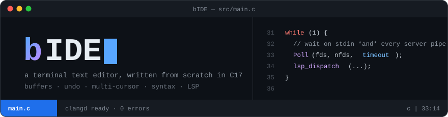

<p align="center">
  
</p>

<p align="center">
  <a href="#building"></a>
  
  
</p>

---

**bIDE** is a modeless terminal text editor built from nothing but libc and the
terminal itself — no ncurses, no JSON library, no dependencies at all. It draws
with raw escape codes, speaks the Language Server Protocol over pipes, and its
whole event loop is one `poll()`.

It started as a read-only file viewer and grew into something that can actually
edit code: multiple buffers, split panes, undo, multi-cursor, incremental search, syntax
highlighting, and language-server-backed completion, diagnostics and go-to-definition.

## Features

| | |
|---|---|
| **Editing** | insert, delete, save; Enter keeps the line's indentation; CRLF preserved on round-trip; tabs rendered to a 4-column stop |
| **Undo/redo** | coalesced into runs, so a typed word undoes as a word |
| **Multi-cursor** | add cursors above/below, or at the next occurrence of the word under the cursor |
| **Search** | incremental, wrapping, with the match highlighted as you type |
| **Syntax** | C and Python — keywords, types, strings, numbers, line and block comments |
| **Buffers** | open many files, cycle, close, or jump via a fuzzy switcher |
| **Panes** | tmux-style splits, side by side or stacked and nested, each with its own cursor even on the same file |
| **Command palette** | fuzzy-searchable, and it doubles as the keymap documentation |
| **File picker** | fuzzy open across a cached recursive scan of the tree |
| **LSP** | completion, hover, diagnostics, go-to-definition and a jump-back stack, over `clangd` and `pylsp` |
| **Copy/paste** | select with Shift or a drag; copy reaches the system clipboard, and pastes go in literally as one undo step |
| **Mouse** | click to position the cursor, drag to select, wheel to scroll |

Async work never blocks the keyboard: the loop waits on stdin *and* every
language server pipe at once, sleeps exactly as long as the nearest pending
thing, and only redraws when something actually changed.

## Building

Needs `gcc` (or `clang`), `make`, and a POSIX terminal — Linux, macOS, or WSL.

```sh
make          # -> bin/main
./bin/main src/main.c
./bin/main --no-rain src/main.c   # skip the startup effect
./bin/main --art logo.txt src/main.c   # different art over the rain
```

On startup, Matrix rain falls over the terminal and uncovers the editor, with
[`assets/bIDE.txt`](assets/bIDE.txt) held above it until it dissolves into the
editor too. Any key skips it. Art that is missing or bigger than the terminal is
left out; spaces in it are transparent.

Optional extras:

```sh
make compdb   # compile_commands.json, so clangd resolves the project's own headers
make asan     # rebuild with AddressSanitizer + UBSan
make clean
```

To get a `bide` command on your PATH, run the installer once:

```sh
sh scripts/start.sh          # builds, then installs to ~/.local/bin/bide
BINDIR=/usr/local/bin sh scripts/start.sh   # or somewhere else
```

Then `bide file.c` works from any directory. It installs a two-line wrapper
rather than a symlink, so it keeps pointing at the current binary after you
rebuild. Note that bIDE writes its LSP transcript to `lsp.log` in whatever
directory you launch it from.

Language servers are optional and detected by file extension. Install
[`clangd`](https://clangd.llvm.org/) for C and
[`pylsp`](https://github.com/python-lsp/python-lsp-server) for Python; without
them everything else still works.

## Keys

Press <kbd>Ctrl</kbd>+<kbd>\\</kbd> (or <kbd>Ctrl</kbd>+<kbd>K</kbd>) for the palette — it
lists every command with its binding, which is the authoritative version of this table.

| Key | | Key | |
|---|---|---|---|
| <kbd>Ctrl</kbd>+<kbd>S</kbd> | Save | <kbd>Ctrl</kbd>+<kbd>G</kbd> | Go to definition |
| <kbd>Ctrl</kbd>+<kbd>O</kbd> | Open file… | <kbd>Ctrl</kbd>+<kbd>T</kbd> | Jump back |
| <kbd>Ctrl</kbd>+<kbd>F</kbd> | Find in file | <kbd>Ctrl</kbd>+<kbd>L</kbd> | Hover docs |
| <kbd>Ctrl</kbd>+<kbd>Z</kbd> / <kbd>Y</kbd> | Undo / redo | <kbd>Ctrl</kbd>+<kbd>Space</kbd> | Complete |
| <kbd>Ctrl</kbd>+<kbd>N</kbd> / <kbd>P</kbd> | Next / prev buffer | <kbd>Ctrl</kbd>+<kbd>E</kbd> / <kbd>A</kbd> | Next / prev diagnostic |
| <kbd>Ctrl</kbd>+<kbd>B</kbd> | Switch buffer… | <kbd>Ctrl</kbd>+<kbd>D</kbd> | Cursor at next match |
| <kbd>Ctrl</kbd>+<kbd>W</kbd> | Close buffer | <kbd>Ctrl</kbd>+<kbd>↑</kbd> / <kbd>↓</kbd> | Add cursor above / below |
| <kbd>Ctrl</kbd>+<kbd>\\</kbd> or <kbd>K</kbd> | Command palette | <kbd>Esc</kbd> | Collapse to one cursor |
| <kbd>Ctrl</kbd>+<kbd>Shift</kbd>+<kbd>Q</kbd> | Quit | <kbd>Ctrl</kbd>+<kbd>R</kbd> | Rescan files |
| <kbd>Ctrl</kbd>+<kbd>←</kbd> / <kbd>→</kbd> | Word left / right | <kbd>Ctrl</kbd>+<kbd>U</kbd> | Configure keybindings… |
| <kbd>Ctrl</kbd>+<kbd>]</kbd> | Pane prefix, [below](#panes) | <kbd>Ctrl</kbd>+<kbd>X</kbd> / <kbd>C</kbd> / <kbd>V</kbd> | Cut / copy / paste, [below](#copy-and-paste) |

The palette, keybinding and pane keys are ones both VS Code's terminal and
Windows Terminal pass through. Quit is <kbd>Ctrl</kbd>+<kbd>Shift</kbd>+<kbd>Q</kbd>
because VS Code keeps <kbd>Ctrl</kbd>+<kbd>Q</kbd> (Quick Open View); terminals that
can't report Shift send it as a plain <kbd>Ctrl</kbd>+<kbd>Q</kbd>, which quits too.
VS Code also keeps <kbd>Ctrl</kbd>+<kbd>P</kbd> and <kbd>Ctrl</kbd>+<kbd>E</kbd> (Go to
File), so in its terminal, give previous buffer and next diagnostic a key of their
own in `keys.conf`.

### Copy and paste

Hold <kbd>Shift</kbd> with any movement key (arrows, <kbd>Home</kbd>/<kbd>End</kbd>,
<kbd>PgUp</kbd>/<kbd>PgDn</kbd>, <kbd>Ctrl</kbd>+<kbd>←</kbd>/<kbd>→</kbd>) to select,
or drag with the mouse. Typing, <kbd>Enter</kbd>, <kbd>Backspace</kbd> or a paste
replaces the selection.

<kbd>Ctrl</kbd>+<kbd>C</kbd> copies the selection to the system clipboard, and
<kbd>Ctrl</kbd>+<kbd>X</kbd> cuts it there. bide asks the terminal to do it (OSC 52),
which Windows Terminal and VS Code both support, and which works from inside WSL
or over SSH. Paste with the terminal's
own paste (<kbd>Ctrl</kbd>+<kbd>V</kbd> in both, or a right-click): bide turns on
bracketed paste, so the text goes in exactly as copied, without auto-closed
brackets or extra indentation, and undoes in one step. Where the terminal passes <kbd>Ctrl</kbd>+<kbd>V</kbd>
through instead, it pastes bide's last copy.

### Panes

<kbd>Ctrl</kbd>+<kbd>]</kbd> is the pane prefix, the way <kbd>Ctrl</kbd>+<kbd>B</kbd> is
tmux's, and the key after it does what it does in tmux:

| After <kbd>Ctrl</kbd>+<kbd>]</kbd> | |
|---|---|
| <kbd>%</kbd> | Split side by side |
| <kbd>"</kbd> | Split top and bottom |
| <kbd>←</kbd> <kbd>→</kbd> <kbd>↑</kbd> <kbd>↓</kbd> | Focus the pane that way |
| <kbd>x</kbd> | Close the pane (its file stays open) |

Clicking or scrolling in a pane focuses it too. Every pane action is also in the
palette, and can be given a key of its own in `keys.conf`.

### Rebinding

<kbd>Ctrl</kbd>+<kbd>U</kbd> (or *Configure keybindings…* in the palette) lists
every command; pick one and press its new key, or Backspace to put it back to
its default. The change is written to `keys.conf` straight away.

A <kbd>Ctrl</kbd>+<kbd>Shift</kbd>+letter can be bound too, but only works in
terminals that report it as its own key (kitty's keyboard protocol, which VS Code's
terminal has on by default, or xterm's modifyOtherKeys); elsewhere it arrives as
the plain <kbd>Ctrl</kbd>+letter, or not at all.

Or edit the file by hand: put overrides in `~/.config/bide/keys.conf` (or `$XDG_CONFIG_HOME/bide/keys.conf`),
one `<command> <key>` per line. Command ids and key names are exactly what the
palette's command table in [`src/command.c`](src/command.c) and its key column use.

```
# command        key
file.save        Ctrl-G
lsp.definition   Ctrl-S     # a key moves: Ctrl-S no longer saves
buffer.next      Ctrl-Down  # a second line for the same command adds a key
buffer.next      Ctrl-J
```

The first line for a command replaces its default keys. Movement, Enter, Tab,
Backspace, Del, Esc, <kbd>Ctrl</kbd>+<kbd>←</kbd>/<kbd>→</kbd>, undo/redo
(<kbd>Ctrl</kbd>+<kbd>Z</kbd>/<kbd>Y</kbd>) and cut/copy/paste
(<kbd>Ctrl</kbd>+<kbd>X</kbd>/<kbd>C</kbd>/<kbd>V</kbd>) are fixed. A bad line is skipped and reported on the status line.

## Layout

```
include/          public headers, one per module
src/
  main.c          poll loop and startup
  terminal.c      raw mode, window size, SIGWINCH, restore on crash
  rain.c          the startup effect
  buffer.c        rows, files, open buffers
  pane.c          the split tree: layout, focus, split, close
  input.c         key decoding and editing operations
  render.c        the screen, status bar, prompts
  command.c       command table, keymap, palette
  undo.c          undo/redo stacks
  search.c        incremental find
  syntax.c        highlight rules for C and Python
  lsp.c           server processes, framing, requests
  lspfeat.c       completion, hover, diagnostics, definition
  json.c          the JSON parser/writer LSP needs
  popup.c         floating windows
  fuzzy.c         subsequence scoring
  list.c          the scrolling list widget
  files.c         recursive file scan
  wrappers.c      syscall wrappers that die loudly
```

## Status

Working editor, still growing.
